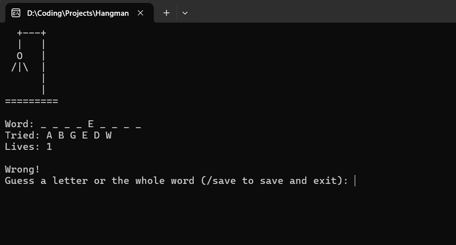

# Hangman

Console hangman game written in C++, with user accounts, saved games, leaderboard 
and ASCII drawing of the hangman.

## Features

- Register and log in with username, email and password
- Reset a password of an existing account with email
- A random word is picked from a word list and the player can guess one letter at a time or the whole word
- ASCII drawing of the hangman and 6 lives per game
- Users can save a game with `/save` and continue it later (one saved game per user)
- Get one point for every won game
- Leaderboard sorted by score
- Add new word to word list from the main menu
- Type `/back` at any prompt during registration or login to go back

## Example



## Building and running

Requires a compiler with C++17 support. The game clears the console with `cls`, so it is meant for Windows.

**Visual Studio:** open `Hangman.sln` and press `Ctrl+F5`.

**g++:** run these in the project folder:

```bash
g++ -std=c++17 src/*.cpp -o hangman.exe
.\hangman.exe
```
Run the game from the project folder, because it reads and writes its files in `data/`.

## Project structure

```
src/
    main.cpp        entry point
    Menu            all screens and user input
    Hangman_game    game rules, saving and loading game
    Registration    loading, saving and checking user accounts
    USERS           one user account
    Leaderboard     sorting and printing of users
data/
    words.txt       the collection of words
```

`data/users_collection.txt` and `data/save_<username>.txt` are created while playing.

## File formats

- `users_collection.txt`: one user per line: `username password email score`
- `save_<username>.txt`: the word, the revealed letters, the guessed letters and the number of misses, each on its own line

## Possible improvements

Passwords are stored as plain text. A future version should store only a hash of each password.